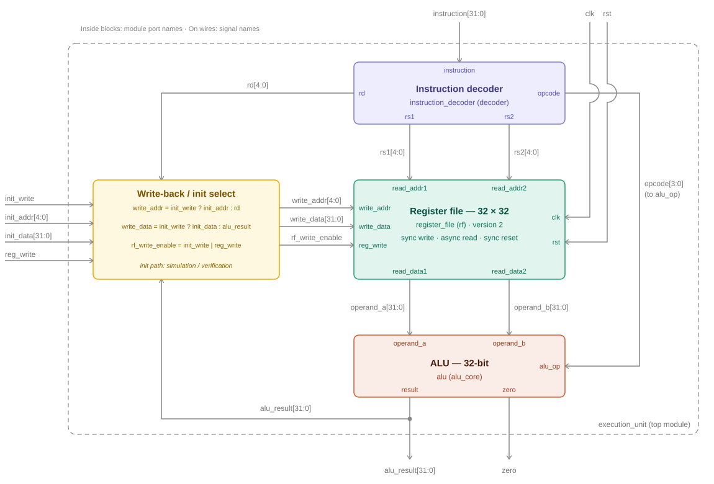
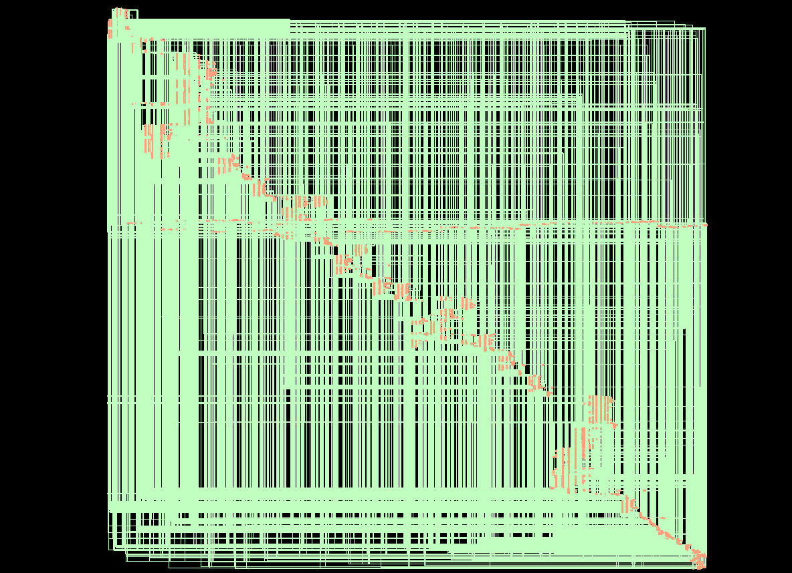
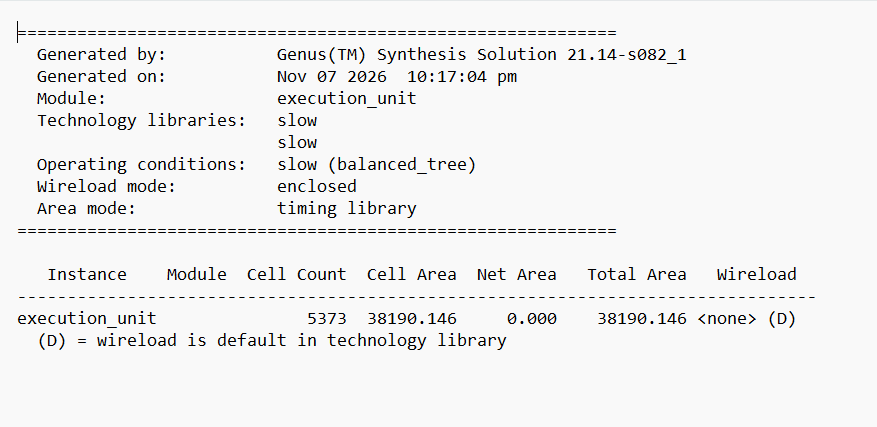
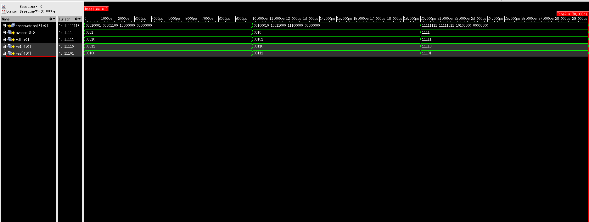
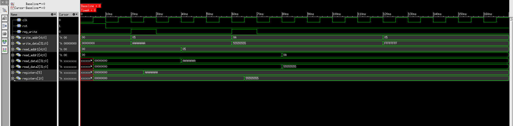
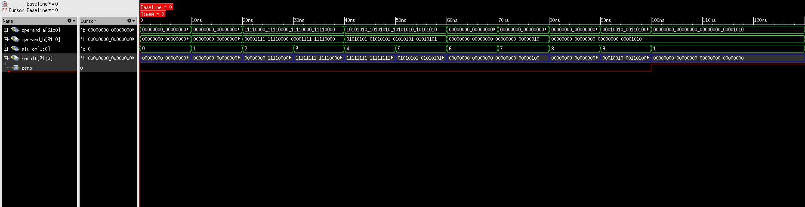
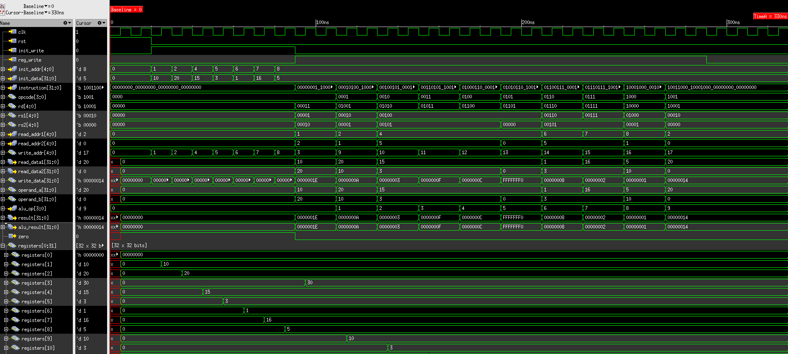
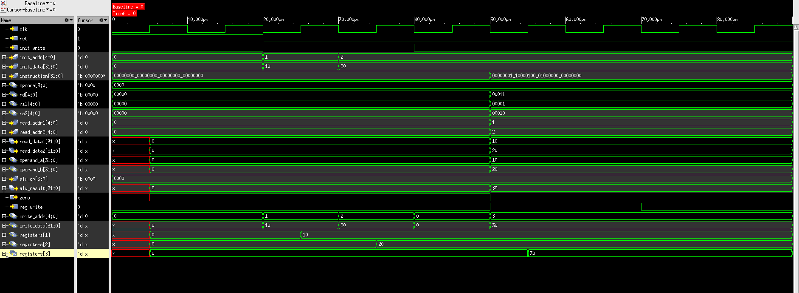

# Execution-Unit-RTL-to-GDSII


RTL-to-GDSII implementation of a 32-bit Processor Execution Unit (Instruction Decoder + Register File + ALU) using Verilog HDL, Cadence Xcelium, Cadence Genus and Cadence Innovus.

**[Overview](#-project-overview)** · **[Architecture](#-architecture)** · **[ASIC Implementation](#-asic-implementation)** · **[RTL Synthesis](#-rtl-synthesis)** · **[Area Analysis](#-area-analysis)** · **[Progress](#-project-progress)** · **[Roadmap](#-project-roadmap)** · **[Verification](#-functional-verification)**

---

## 📌 Project Overview

This project demonstrates the complete **RTL-to-GDSII implementation flow** of a processor execution unit. Starting from a 32-bit instruction, the design decodes the instruction, reads operands from a 32×32 Register File, performs an arithmetic or logical operation in the ALU, and writes the result back to the destination register.

**Current stage:** the Instruction Decoder, Register File (Version 2) and ALU are integrated in the `execution_unit` top module and the complete datapath has been functionally verified (10 of 10 ALU operations pass in Cadence Xcelium / SimVision). The RTL has been **synthesized with Cadence Genus** on a 90 nm standard-cell library, and the **area report has been analyzed**: the design maps to 5373 standard cells. The next phase is gate-level, timing and power analysis, followed by physical design in Cadence Innovus.

The entire flow — from RTL design through synthesis, physical design, and timing closure — is implemented using industry-standard Cadence EDA tools on Linux.

---

## 📚 Documentation

| Document | Description |
|----------|-------------|
| [Architecture](docs/Architecture.md) | Block diagram, module descriptions, interfaces and data flow |
| [Instruction Set](docs/Instruction_Set.md) | 32-bit instruction format and supported operations |
| [Project Plan](docs/Project_Plan.md) | Phases and milestones |
| [Progress Log](docs/Progress_Log.md) | Chronological engineering log |
| [Day 2 Update](docs/Day02_Update.md) | Instruction Decoder RTL and verification |
| [Day 3 Update](docs/Day03_Update.md) | Register File RTL and verification |
| [Day 4 Update](docs/Day04_Update.md) | ALU RTL and verification |
| [Day 5 Update](docs/Day05_Update.md) | Execution Unit integration and first datapath run |
| [Day 6 Update](docs/Day06_Update.md) | Comprehensive functional verification of all ALU operations |
| [Day 7 Update](docs/Day07_Update.md) | ASIC synthesis environment setup — SDC, Genus script and project organization |
| [Day 8 Update](docs/Day08_Update.md) | RTL synthesis with Cadence Genus — gate-level netlist and reports |
| [Day 9 Update](docs/Day09_Update.md) | Area analysis of the synthesized Execution Unit |

---

## 🆕 Current Progress

### Day 9 Progress — Area Analysis after RTL Synthesis

Analyzed the area report generated by Cadence Genus for the synthesized Execution Unit.

- Reviewed `synthesis/reports/area.rpt` for the `execution_unit` top module (90 nm library, slow corner)
- The RTL was mapped to **5373 standard-cell instances**
- **Cell Area: 38190.146 µm² · Net Area: 0.000 µm² · Total Area: 38190.146 µm²**
- Net Area is zero because no placement or routing exists yet, so Total Area equals Cell Area
- Synthesis completed without errors

**Next:** gate-level analysis, followed by timing and power analysis.

<details>
<summary>Previous progress</summary>

**Day 8 — RTL Synthesis with Cadence Genus.** Synthesized the complete Execution Unit into a gate-level netlist on the 90 nm library and generated the area, gates, timing and power reports. No synthesis errors were encountered.

**Day 7 — ASIC Synthesis Environment Setup.** Organized the repository into a professional ASIC project structure, created the first SDC file (100 MHz clock with input and output delays) and the automated Genus script, and configured the 90 nm library.

**Day 6 — Comprehensive Functional Verification.** Verified all 10 ALU operations end to end through the Execution Unit with a self-checking testbench. 10 of 10 tests passed in Cadence Xcelium.

**Day 5 — Execution Unit Integration.** Integrated the Instruction Decoder, Register File (Version 2) and ALU in `execution_unit`, added the register-initialization interface and verified a first instruction (`ADD R3, R1, R2`) through the full datapath.

**Day 4 — ALU RTL Complete.** Synthesizable 32-bit combinational ALU with 10 operations and a zero flag. All 11 directed checks passed.

**Day 3 — Register File RTL Complete.** Synthesizable 32×32 Register File with dual asynchronous read ports, a single synchronous write port and synchronous active-high reset. All 4 directed tests passed.

**Day 2 — Instruction Decoder RTL Complete.** Purely combinational decoder parameterized with `defines.vh`. All 3 directed tests passed.

</details>

---

## ✨ Features

- Parameterized 32-bit instruction decoding using `defines.vh`
- 32×32 Register File (Version 2) — dual asynchronous read, single synchronous write, synchronous reset
- 32-bit ALU with 10 operations and zero flag
- Integrated `execution_unit` top module with write-back path
- Register-initialization interface for simulation and verification
- Self-checking system-level testbench covering all 10 ALU operations
- SDC timing constraints (100 MHz) and automated Cadence Genus synthesis script
- Gate-level netlist synthesized with Cadence Genus on a 90 nm standard-cell library
- Physical Design using Cadence Innovus
- Static Timing Analysis (STA)
- Timing Closure

---

## 🏗 Architecture



| Block | Status | Verification |
|-------|--------|--------------|
| Instruction Decoder | ✅ Complete | 3/3 module tests |
| Register File (Version 2) | ✅ Complete | 4/4 module tests (Day 3) · used in all 10 integrated tests |
| ALU | ✅ Complete | 11/11 module checks |
| Execution Unit (top) | ✅ Complete | ✅ 10/10 operations verified end to end |

**Data flow**

```
Instruction → Instruction Decoder → Register File (read) → ALU → Write-Back → Destination Register
```

### Execution Unit

`execution_unit` instantiates the decoder, register file and ALU and adds a write-back select that shares the Register File's single write port between normal write-back and register initialization. All ten ALU operations have been verified through this integrated datapath (see [Functional Verification](#-functional-verification)).

| Port | Direction | Width | Description |
|------|-----------|-------|-------------|
| `clk` | Input | 1 | System clock |
| `rst` | Input | 1 | Reset, applied to the Register File |
| `reg_write` | Input | 1 | Normal write-back enable |
| `init_write` | Input | 1 | Register-initialization enable (simulation / verification) |
| `init_addr` | Input | 5 | Register to initialize |
| `init_data` | Input | 32 | Initialization value |
| `instruction` | Input | 32 | Instruction word |
| `alu_result` | Output | 32 | ALU result |
| `zero` | Output | 1 | ALU zero flag |

> Full details in [docs/Architecture.md](docs/Architecture.md).

---

## 🏭 ASIC Implementation

> **Status:** RTL synthesis (Day 8) and area analysis (Day 9) completed — see [RTL Synthesis](#-rtl-synthesis) and [Area Analysis](#-area-analysis). Gate-level, timing and power analysis will follow in upcoming updates.

### ASIC Flow

```
RTL                          ✅ Complete
  ↓
Timing Constraints (SDC)     ✅ Complete
  ↓
Cadence Genus                ✅ Complete
  ↓
Synthesis                    ✅ Complete
  ↓
Area Analysis                ✅ Complete
  ↓
Gate-Level Analysis          🔜 Next
  ↓
Timing Analysis              ⏳ Pending
  ↓
Power Analysis               ⏳ Pending
  ↓
Cadence Innovus              ⏳ Pending
  ↓
Physical Design              ⏳ Pending
  ↓
GDSII                        ⏳ Pending
```

### Synthesis Setup

| Item | Configuration |
|------|---------------|
| Tool | Cadence Genus |
| Top module | `execution_unit` |
| Technology library | 90 nm standard-cell library (`slow.lib`), provided by the laboratory |
| Operating corner | slow |
| Target clock | 100 MHz (10 ns period) |
| Constraints | [`constraints/execution_unit.sdc`](constraints/execution_unit.sdc) |
| Script | [`synthesis/scripts/run_genus.tcl`](synthesis/scripts/run_genus.tcl) |

### Timing Constraints

| Constraint | Value | Applied to |
|------------|-------|------------|
| Primary clock | `clk`, 10 ns period (100 MHz) | Port `clk` |
| Input delay | 2 ns relative to `clk` | All inputs except `clk` |
| Output delay | 2 ns relative to `clk` | All outputs |

```tcl
create_clock -name clk -period 10 [get_ports clk]

set_input_delay 2 -clock clk [remove_from_collection [all_inputs] [get_ports clk]]

set_output_delay 2 -clock clk [all_outputs]
```

### Synthesis Preparation Workflow

1. ✅ Organize the repository into a professional ASIC project structure
2. ✅ Move RTL into `rtl/` and testbenches into `tb/`
3. ✅ Write timing constraints (`constraints/execution_unit.sdc`)
4. ✅ Write the Genus synthesis script (`synthesis/scripts/run_genus.tcl`)
5. ✅ Configure the 90 nm technology library
6. ✅ Create synthesis output directories (`reports`, `netlist`, `database`, `logs`)
7. ✅ Run synthesis (Day 8)
8. ✅ Analyze the area report (Day 9)
9. ⏳ Analyze the gate-level, timing and power reports

### Genus Script Flow

| Step | Command | Purpose |
|------|---------|---------|
| 1 | `read_lib` | Read the technology library |
| 2 | `read_hdl` | Read `defines.vh` and the four RTL modules |
| 3 | `elaborate execution_unit` | Elaborate the top module |
| 4 | `read_sdc` | Read the timing constraints |
| 5 | `check_design` | Check the design |
| 6 | `syn_gen` | Generic synthesis |
| 7 | `syn_map` | Technology mapping |
| 8 | `syn_opt` | Logic optimization |
| 9 | `report area / gates / timing / power` | Generate reports |
| 10 | `write_hdl` | Write the gate-level netlist |

> The technology library belongs to the laboratory environment and is not included in this repository. The script currently uses absolute paths from the lab workstation.

---

## 🔧 RTL Synthesis

> **Status:** ✅ RTL successfully synthesized with Cadence Genus. No synthesis errors were encountered. Area analysis is documented in [Area Analysis](#-area-analysis); gate-level, timing and power analysis will be documented in upcoming updates.

### Synthesis Workflow

```
RTL Design                      rtl/ — defines.vh and four modules
        ↓
Read Technology Library         slow.lib — 90 nm, slow corner
        ↓
Read RTL Files
        ↓
Design Elaboration              top module: execution_unit
        ↓
Read Timing Constraints         execution_unit.sdc — 100 MHz
        ↓
Design Checking
        ↓
Generic Synthesis               syn_gen
        ↓
Technology Mapping              syn_map
        ↓
Logic Optimization              syn_opt
        ↓
Synthesis Reports               area, gates, timing, power
        ↓
Gate-Level Netlist              execution_unit_syn.v
```

### Cadence Genus Overview

Cadence Genus is a logic synthesis tool. It translates RTL into a gate-level netlist built from the cells of a target standard-cell library, optimizing the result against the timing constraints. In this project it runs through a single automated script, `synthesis/scripts/run_genus.tcl`.

| Stage | Command | What it does |
|-------|---------|--------------|
| Generic synthesis | `syn_gen` | Converts the elaborated RTL into generic logic, independent of any library |
| Technology mapping | `syn_map` | Maps the generic logic onto the 90 nm standard cells |
| Logic optimization | `syn_opt` | Optimizes the mapped netlist against the timing constraints |

### Synthesis Configuration

| Item | Configuration |
|------|---------------|
| Top module | `execution_unit` |
| RTL synthesized | `defines.vh`, `instruction_decoder.v`, `register_file.v`, `alu.v`, `execution_unit.v` |
| Technology library | 90 nm standard-cell library — `slow.lib` |
| Operating corner | slow |
| Constraints | `execution_unit.sdc` — 10 ns clock (100 MHz), input and output delays |
| Script | `run_genus.tcl` |

### Generated Outputs

| Output | Location | Status |
|--------|----------|--------|
| Gate-level netlist | `synthesis/netlist/execution_unit_syn.v` | ✅ Generated |
| Area report | `synthesis/reports/area.rpt` | ✅ Generated |
| Gates report | `synthesis/reports/gates.rpt` | ✅ Generated |
| Timing report | `synthesis/reports/timing.rpt` | ✅ Generated |
| Power report | `synthesis/reports/power.rpt` | ✅ Generated |

### Synthesis Status

| Check | Status |
|-------|--------|
| RTL successfully synthesized | ✅ |
| Technology mapping completed | ✅ |
| Gate-level netlist generated | ✅ |
| Reports generated | ✅ |
| Synthesis errors | None encountered |

### Synthesis Screenshots

#### Synthesis Completion


*Cadence Genus — synthesis run completed for `execution_unit`.*

#### Gate-Level Schematic



*Synthesized gate-level schematic of `execution_unit`, mapped to the 90 nm standard-cell library.*

#### Generated Reports


*Synthesis reports generated in `synthesis/reports/`.*

#### Project Directory After Synthesis


*Project directory after synthesis, with the generated reports and netlist in `synthesis/`.*

### Next Development Phase

The synthesis outputs are ready for analysis. Area analysis is complete. The remaining reports will be reviewed and documented in upcoming daily updates, followed by physical design in Cadence Innovus.

| Analysis | Source | Status |
|----------|--------|--------|
| Area Analysis | `synthesis/reports/area.rpt` | ✅ Complete |
| Gate-Level Analysis | `synthesis/reports/gates.rpt` | 🔜 Next |
| Timing Analysis | `synthesis/reports/timing.rpt` | ⏳ Pending |
| Power Analysis | `synthesis/reports/power.rpt` | ⏳ Pending |
| Cadence Innovus Setup | `synthesis/netlist/execution_unit_syn.v` | ⏳ Pending |

> Details and notes in [docs/Day08_Update.md](docs/Day08_Update.md).

---

## 📐 Area Analysis

> **Status:** ✅ Area report analyzed (Day 9). Gate-level, timing and power analysis will follow in upcoming updates.

### Purpose

Area analysis shows how the RTL was translated into standard cells and how much cell area the synthesized design occupies. It gives an early measure of design size before physical implementation. Area matters because it affects manufacturing cost, routing congestion, power consumption and overall chip size.

### Report Configuration

| Item | Value |
|------|-------|
| Report | `synthesis/reports/area.rpt` |
| Top module | `execution_unit` |
| Technology library | 90 nm standard-cell library (`slow.lib`) |
| Library corner | slow |
| Wireload mode | enclosed |
| Operating condition | slow (balanced_tree) |

### Area Analysis Results

| Metric | Value |
|--------|-------|
| Cell Count | **5373** standard cells |
| Cell Area | **38190.146 µm²** |
| Net Area | 0.000 µm² |
| Total Area | **38190.146 µm²** |

> Area values are reported in µm².

### Explanation of Net Area

Net Area is the area attributed to wiring. Synthesis happens before placement and routing, so no physical wiring exists yet and the report shows `0.000`. Total Area is therefore equal to Cell Area. Wiring is only known after placement and routing in Cadence Innovus.

### Summary of Observations

- The complete Execution Unit was mapped to **5373 standard-cell instances** using the 90 nm library
- **Cell Area (38190.146 µm²)** is the total area of all synthesized standard cells
- **Net Area is 0.000**, so **Total Area equals Cell Area**
- Synthesis completed without errors
- This is a pre-layout figure and will be revisited after physical implementation

### Why Area Matters

| Impact | Relationship |
|--------|--------------|
| Manufacturing cost | Larger area means fewer dies per wafer |
| Routing congestion | More cells need more wiring |
| Power consumption | More cells add leakage and switching capacitance |
| Overall chip size | Cell area sets a lower bound on the chip size |

### Area Analysis Screenshots

#### Area Report



*Area report generated by Cadence Genus for `execution_unit`.*

#### Synthesis Summary


*Synthesis summary with the total cell area highlighted.*

#### Design Browser


*Genus Design Browser showing the synthesized `execution_unit` design.*

#### Area Report — Terminal Output


*Area report terminal output.*

### Next Step

Gate-level analysis of `synthesis/reports/gates.rpt`, followed by timing and power analysis. Details and notes in [docs/Day09_Update.md](docs/Day09_Update.md).

---

## 📁 Directory Structure

```
Execution-Unit-RTL-to-GDSII/
│
├── rtl/
│   ├── defines.vh                  ← Global macro definitions ✅
│   ├── instruction_decoder.v       ← Instruction Decoder ✅
│   ├── register_file.v             ← 32×32 Register File (Version 2) ✅
│   ├── alu.v                       ← 32-bit ALU ✅
│   └── execution_unit.v            ← Execution Unit top module ✅
│
├── tb/
│   ├── tb_instruction_decoder.v    ← Instruction Decoder Testbench ✅
│   ├── register_file_tb.v          ← Register File Testbench ✅
│   ├── alu_tb.v                    ← ALU Testbench ✅
│   └── execution_unit_tb.v         ← Execution Unit Testbench — 10-operation, self-checking ✅
│
├── constraints/
│   └── execution_unit.sdc          ← Timing constraints, 100 MHz ✅
│
├── synthesis/
│   ├── scripts/
│   │     └── run_genus.tcl         ← Cadence Genus synthesis script ✅
│   ├── reports/
│   │     ├── area.rpt              ← Area report ✅ (analyzed)
│   │     ├── gates.rpt             ← Gates report ✅
│   │     ├── timing.rpt            ← Timing report ✅
│   │     └── power.rpt             ← Power report ✅
│   ├── netlist/
│   │     └── execution_unit_syn.v  ← Gate-level netlist ✅
│   ├── database/                   ← Reserved for the Genus database
│   └── logs/                       ← Reserved for Genus logs
│
├── images/
│   ├── architecture.svg
│   ├── simulation/
│   │     ├── instruction_decoder_waveform.png              ← Verified ✅
│   │     ├── register_file_waveform.png                    ← Verified ✅
│   │     ├── alu_waveform.png                              ← Verified ✅
│   │     ├── execution_unit_waveform.png                   ← Day 5 first datapath run ✅
│   │     └── execution_unit_all_operations_waveform.png    ← Day 6 all 10 operations ✅
│   └── synthesis/
│         ├── genus_synthesis_completion.png                ← Day 8 ✅
│         ├── genus_gate_level_schematic.png                ← Day 8 ✅
│         ├── genus_synthesis_reports.png                   ← Day 8 ✅
│         ├── project_directory_after_synthesis.png         ← Day 8 ✅
│         ├── genus_area_report.png                         ← Day 9 ✅
│         ├── genus_synthesis_summary_area.png              ← Day 9 ✅
│         ├── genus_design_browser.png                      ← Day 9 ✅
│         └── genus_area_report_terminal.png                ← Day 9 ✅
│
├── reports/
│   └── execution_unit_simulation_transcript.txt   ← Day 6 simulation transcript ✅
├── docs/
│   ├── Project_Plan.md
│   ├── Architecture.md
│   ├── Instruction_Set.md
│   ├── Progress_Log.md
│   ├── Day02_Update.md
│   ├── Day03_Update.md
│   ├── Day04_Update.md
│   ├── Day05_Update.md
│   ├── Day06_Update.md
│   ├── Day07_Update.md
│   ├── Day08_Update.md
│   └── Day09_Update.md
│
├── README.md
├── LICENSE
└── .gitignore
```

---

## 🛠 Toolchain

| Tool | Purpose |
|------|---------|
| Verilog HDL | RTL Design |
| Cadence Xcelium | Simulation |
| Cadence SimVision | Waveform Viewer |
| Synopsys Design Constraints (SDC) | Timing constraints |
| Cadence Genus | Logic Synthesis |
| 90 nm standard-cell library (`slow.lib`) | Target technology, slow corner |
| Cadence Innovus | Physical Design (PnR) |
| Linux | Operating System |

---

## 🚦 Project Progress

| Milestone | Status |
|-----------|--------|
| Project Setup | ✅ Complete |
| RTL Development (incl. `defines.vh`) | ✅ Complete |
| Instruction Decoder | ✅ Complete |
| Register File | ✅ Complete |
| ALU | ✅ Complete |
| Execution Unit | ✅ Complete |
| Functional Verification | ✅ Complete — 10/10 operations passed |
| ASIC Synthesis Environment Setup | ✅ Complete |
| RTL Synthesis | ✅ Complete |
| Area Analysis | ✅ Complete — 5373 cells |
| Gate-Level Analysis | 🔜 Next |
| Timing Analysis | ⏳ Pending |
| Power Analysis | ⏳ Pending |
| Cadence Innovus Setup | ⏳ Pending |
| Floorplanning | ⏳ Pending |
| Placement | ⏳ Pending |
| Clock Tree Synthesis | ⏳ Pending |
| Routing | ⏳ Pending |
| Physical Verification | ⏳ Pending |
| GDSII Generation | ⏳ Pending |

---

## 🗺 Project Roadmap

- [x] Project Setup
- [x] RTL Development
- [x] Instruction Decoder
- [x] Register File
- [x] ALU
- [x] Execution Unit
- [x] Functional Verification
- [x] ASIC Synthesis Environment Setup
- [x] RTL Synthesis
- [x] Area Analysis
- [ ] Gate-Level Analysis
- [ ] Timing Analysis
- [ ] Power Analysis
- [ ] Cadence Innovus Setup
- [ ] Floorplanning
- [ ] Placement
- [ ] Clock Tree Synthesis
- [ ] Routing
- [ ] Physical Verification
- [ ] GDSII Generation

---

## 📊 Simulation Results

### Instruction Decoder



*Cadence SimVision — `instruction[31:0]`, `opcode[3:0]`, `rd[4:0]`, `rs1[4:0]`, `rs2[4:0]` across 3 directed test vectors. Outputs track the input bit-fields with zero propagation delay, confirming purely combinational behavior.*

| Test Case | opcode | rd | rs1 | rs2 | Result |
|-----------|--------|-----|-----|-----|--------|
| TC1 | 0001 | 00010 | 00011 | 00100 | ✅ PASSED |
| TC2 | 0010 | 00101 | 00110 | 00111 | ✅ PASSED |
| TC3 | 1111 | 11111 | 11110 | 11101 | ✅ PASSED |

---

### Register File Verification



*Cadence SimVision — standalone Register File testbench (Day 3), in which the write enable appears as `we`. Version 2 exposes the write enable as `reg_write`, which is how the integrated `execution_unit` drives it.*

| Test | Description | Result |
|------|-------------|--------|
| TEST1 | Write `0xAAAAAAAA` to R5, read R5 | ✅ PASSED |
| TEST2 | Write `0x55555555` to R10, read R10 | ✅ PASSED |
| TEST3 | Simultaneous dual-port read of R5 and R10 | ✅ PASSED |
| TEST4 | Write disabled, R5 unchanged | ✅ PASSED |

---

### ALU Verification



*Cadence SimVision — `operand_a`, `operand_b`, `alu_op`, `result` and `zero`. `alu_op` steps through 0–9 in 10 ns windows (ADD, SUB, AND, OR, XOR, NOT, SLL, SRL, SLT, PASS A), then returns to SUB at 100 ns with equal operands to exercise the zero flag. All 11 checks passed.*

> Module-level details in [Day 2](docs/Day02_Update.md), [Day 3](docs/Day03_Update.md) and [Day 4](docs/Day04_Update.md).

---

## 🔬 Functional Verification

### Execution Unit — All ALU Operations

The complete Execution Unit was verified with a self-checking testbench in **Cadence Xcelium**, with waveforms inspected in **Cadence SimVision**. After reset, the testbench preloads registers through the initialization interface and then runs one instruction for each ALU operation.

**Initial register state**

| Register | Value |
|----------|-------|
| R1 | 10 |
| R2 | 20 |
| R4 | 15 |
| R5 | 3 |
| R6 | 1 |
| R7 | 16 |
| R8 | 5 |

**Path exercised by every instruction**

```
Instruction → Instruction Decoder → Register File Read → ALU Execution → Write Back → Destination Register Updated
```

**Results**

| Test | Operation | Expected ALU Result | Actual ALU Result | Result |
|------|-----------|---------------------|-------------------|--------|
| 1 | ADD | 30 | 30 | ✅ PASS |
| 2 | SUB | 10 | 10 | ✅ PASS |
| 3 | AND | 3 | 3 | ✅ PASS |
| 4 | OR | 15 | 15 | ✅ PASS |
| 5 | XOR | 12 | 12 | ✅ PASS |
| 6 | NOT | `0xFFFFFFF0` | `0xFFFFFFF0` | ✅ PASS |
| 7 | SHIFT LEFT | 8 | 8 | ✅ PASS |
| 8 | SHIFT RIGHT | 2 | 2 | ✅ PASS |
| 9 | SET LESS THAN (SLT) | 1 | 1 | ✅ PASS |
| 10 | PASS A | 20 | 20 | ✅ PASS |

**Total: 10 · Passed: 10 · Failed: 0**

#### Final Waveform



*Cadence SimVision — complete Execution Unit run covering all ten ALU operations. `alu_op` changes with each instruction and `alu_result` takes the expected value for each test in turn: `30`, `10`, `3`, `15`, `12`, `0xFFFFFFF0`, `8`, `2`, `1`, `20`.*

#### Simulation Transcript

```
=========================================
EXECUTION UNIT VERIFICATION SUMMARY
=========================================
Total Tests : 10
Passed      : 10
Failed      : 0
STATUS : ALL TESTS PASSED
=========================================
```

<details>
<summary>Full simulation transcript</summary>

```
-----------------------------------------
RESET COMPLETED
-----------------------------------------
-----------------------------------------
REGISTER INITIALIZATION COMPLETED
-----------------------------------------
-----------------------------------------
TEST 1 : ADD
Expected ALU Result : 30
Actual   ALU Result : 30
RESULT : PASS
-----------------------------------------
-----------------------------------------
TEST 2 : SUB
Expected ALU Result : 10
Actual   ALU Result : 10
RESULT : PASS
-----------------------------------------
-----------------------------------------
TEST 3 : AND
Expected ALU Result : 3
Actual   ALU Result : 3
RESULT : PASS
-----------------------------------------
-----------------------------------------
TEST 4 : OR
Expected ALU Result : 15
Actual   ALU Result : 15
RESULT : PASS
-----------------------------------------
-----------------------------------------
TEST 5 : XOR
Expected ALU Result : 12
Actual   ALU Result : 12
RESULT : PASS
-----------------------------------------
-----------------------------------------
TEST 6 : NOT
Expected ALU Result : FFFFFFF0
Actual   ALU Result : fffffff0
RESULT : PASS
-----------------------------------------
-----------------------------------------
TEST 7 : SHIFT LEFT
Expected ALU Result : 8
Actual   ALU Result : 8
RESULT : PASS
-----------------------------------------
-----------------------------------------
TEST 8 : SHIFT RIGHT
Expected ALU Result : 2
Actual   ALU Result : 2
RESULT : PASS
-----------------------------------------
-----------------------------------------
TEST 9 : SLT
Expected ALU Result : 1
Actual   ALU Result : 1
RESULT : PASS
-----------------------------------------
-----------------------------------------
TEST 10 : PASS A
Expected ALU Result : 20
Actual   ALU Result : 20
RESULT : PASS
-----------------------------------------

=========================================
EXECUTION UNIT VERIFICATION SUMMARY
=========================================
Total Tests : 10
Passed      : 10
Failed      : 0
STATUS : ALL TESTS PASSED
=========================================
```

The same transcript is saved in [reports/execution_unit_simulation_transcript.txt](reports/execution_unit_simulation_transcript.txt).

</details>

#### Datapath Bring-Up (Day 5)



*The first integrated run — initialization of R1 and R2, then `ADD R3, R1, R2` with `R3 = 30` — is explained stage by stage in [docs/Day05_Update.md](docs/Day05_Update.md).*

> Test setup, scope and waveform notes in [docs/Day06_Update.md](docs/Day06_Update.md).

---

## 🔮 Future Work

- **Synthesis report analysis** — gate-level, timing and power
- **Gate-level simulation** of the synthesized netlist
- **Cadence Innovus setup and physical design** — floorplanning, placement, clock tree synthesis, routing, physical verification and GDSII generation
- **Signoff** — static timing analysis and timing closure
- **Additional verification corners** — edge-case operand values, undefined opcodes and dependent instruction sequences

---

## 📄 License

This project is licensed under the MIT License — see [LICENSE](LICENSE) for details.

---

## 👨‍💻 Author

**Arshad Ansari**
M.Tech ECE (VLSI Design) — NIT Hamirpur
[](https://www.linkedin.com/in/arshadansari04/)
[](https://github.com/arshad-vlsi)
