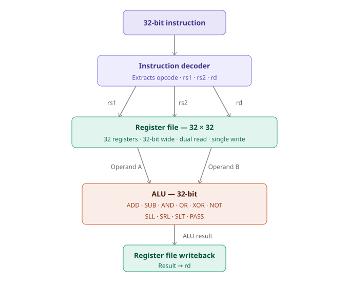
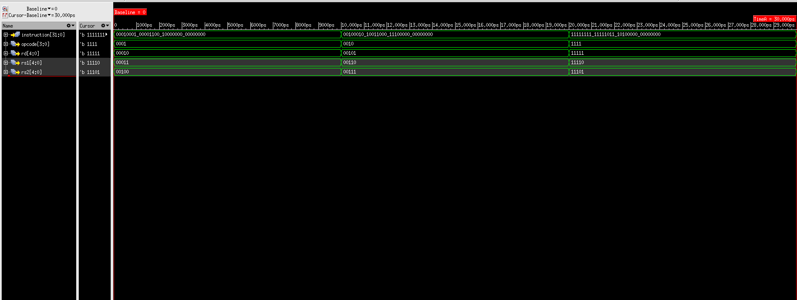
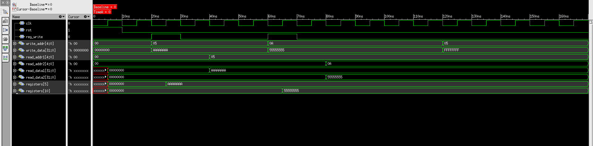

# Execution-Unit-RTL-to-GDSII


RTL-to-GDSII implementation of a 32-bit Processor Execution Unit (Instruction Decoder + Register File + ALU) using Verilog HDL, Cadence Genus and Cadence Innovus.

---

## 📌 Project Description

This project demonstrates the complete **RTL-to-GDSII implementation flow** of a processor execution unit. Starting from a 32-bit instruction, the design decodes the instruction, reads operands from a 32×32 Register File, performs an arithmetic or logical operation in the ALU, and writes the result back to the Register File.

The entire flow — from RTL design through synthesis, physical design, and timing closure — is implemented using industry-standard Cadence EDA tools on Linux.

---

## 🆕 Latest Progress

> **Day 3 — Register File RTL Complete**
>
> A synthesizable 32×32 Register File has been implemented in Verilog HDL with dual asynchronous read ports, a single synchronous write port, and synchronous active-high reset. The module was verified using a 4-test directed testbench in Cadence Xcelium. All 4 test cases passed. Waveform verified in Cadence SimVision.
> **ALU implementation is next.**

---

## ✨ Features

- Parameterized 32-bit instruction decoding using `defines.vh`
- 32×32 Register File — dual async read, single sync write, sync reset
- 32-bit ALU supporting 10 operations
- Complete RTL-to-GDSII flow
- Synthesis using Cadence Genus
- Physical Design using Cadence Innovus
- Static Timing Analysis (STA)
- Timing Closure

---

## 🏗 Architecture



---

## 📁 Directory Structure

```
Execution-Unit-RTL-to-GDSII/
│
├── rtl/
│   ├── defines.vh                  ← Global macro definitions ✅
│   ├── instruction_decoder.v       ← Instruction Decoder ✅
│   ├── register_file.v             ← 32×32 Register File ✅
│   ├── alu.v                       ← 32-bit ALU 🔄
│   └── execution_unit_top.v        ← Top Module ⏳
│
├── tb/
│   ├── tb_instruction_decoder.v    ← Instruction Decoder Testbench ✅
│   └── register_file_tb.v         ← Register File Testbench ✅
│
├── images/
│   └── simulation/
│         ├── instruction_decoder_waveform.png ← Verified ✅
│         └── register_file_waveform.png       ← Verified ✅
│
├── constraints/
│   └── execution_unit.sdc
│
├── scripts/
│   ├── genus.tcl
│   └── innovus.tcl
│
├── genus/
├── innovus/
├── reports/
├── docs/
│   ├── Project_Plan.md
│   ├── Architecture.md
│   ├── Instruction_Set.md
│   ├── Progress_Log.md
│   ├── Day02_Update.md
│   └── Day03_Update.md
│
├── README.md
├── LICENSE
└── .gitignore
```

---

## 🛠 Toolchain

| Tool | Purpose |
|------|---------|
| Verilog HDL | RTL Design |
| Cadence Xcelium | Simulation |
| Cadence SimVision | Waveform Viewer |
| Cadence Genus | Logic Synthesis |
| Cadence Innovus | Physical Design (PnR) |
| Linux | Operating System |

---

## 🚦 Project Status

| Phase | Status |
|-------|--------|
| Architecture Planning | ✅ Complete |
| Repository Initialization | ✅ Complete |
| defines.vh | ✅ Complete |
| Instruction Decoder RTL | ✅ Complete |
| Instruction Decoder Verification | ✅ Complete |
| Register File RTL | ✅ Complete |
| Register File Verification | ✅ Complete |
| ALU RTL | 🔄 Next Module |
| Top Module | ⏳ Pending |
| Full Verification | 🔄 In Progress |
| Synthesis (Genus) | ⏳ Pending |
| Physical Design (Innovus) | ⏳ Pending |
| STA & Timing Closure | ⏳ Pending |
| GDSII | ⏳ Pending |

---

## 🗺 Development Roadmap

```
Phase 1 — RTL Design
  ├── defines.vh                ✅ Complete
  ├── instruction_decoder.v     ✅ Complete — 3/3 tests passed
  ├── register_file.v           ✅ Complete — 4/4 tests passed
  ├── alu.v                     🔄 Next Module
  └── execution_unit_top.v      ⏳ Pending

Phase 2 — Verification
  ├── tb_instruction_decoder.v  ✅ Complete
  ├── register_file_tb.v        ✅ Complete
  └── tb_execution_unit.v       ⏳ Upcoming

Phase 3 — Synthesis (Cadence Genus)
  ├── genus.tcl
  └── Netlist + Reports

Phase 4 — Physical Design (Cadence Innovus)
  ├── Floorplanning
  ├── Placement
  ├── Clock Tree Synthesis (CTS)
  ├── Routing
  └── GDSII

Phase 5 — Signoff
  ├── STA
  ├── Timing Closure
  └── Final GDSII
```

---

## 📊 Simulation Results

### Instruction Decoder



> **Cadence SimVision** — Waveform showing `instruction[31:0]`, `opcode[3:0]`, `rd[4:0]`, `rs1[4:0]`, `rs2[4:0]` across 3 directed test vectors. All outputs track input bit-fields with zero propagation delay — confirming purely combinational behavior. **All 3 test cases passed.**

---

### Register File



> **Cadence SimVision** — Waveform showing `clk`, `rst`, `we`, `write_addr[4:0]`, `write_data[31:0]`, `read_addr1[4:0]`, `read_addr2[4:0]`, `read_data1[31:0]`, `read_data2[31:0]`, `register_file[5]` and `register_file[10]` across 4 directed test cases.

| Test | Description | Result |
|------|-------------|--------|
| TEST1 | Write `0xAAAAAAAA` to R5 → Read R5 | ✅ PASSED |
| TEST2 | Write `0x55555555` to R10 → Read R10 | ✅ PASSED |
| TEST3 | Simultaneous dual-port read R5 & R10 | ✅ PASSED |
| TEST4 | Write disabled (we=0) — R5 unchanged | ✅ PASSED |

**All 4 test cases passed.**

---

## 📄 License

This project is licensed under the MIT License — see [LICENSE](LICENSE) for details.

---

## 👨‍💻 Author

**Arshad Ansari**
M.Tech ECE (VLSI Design) — NIT Hamirpur
[](https://www.linkedin.com/in/arshadansari04/)
[](https://github.com/arshad-vlsi)
