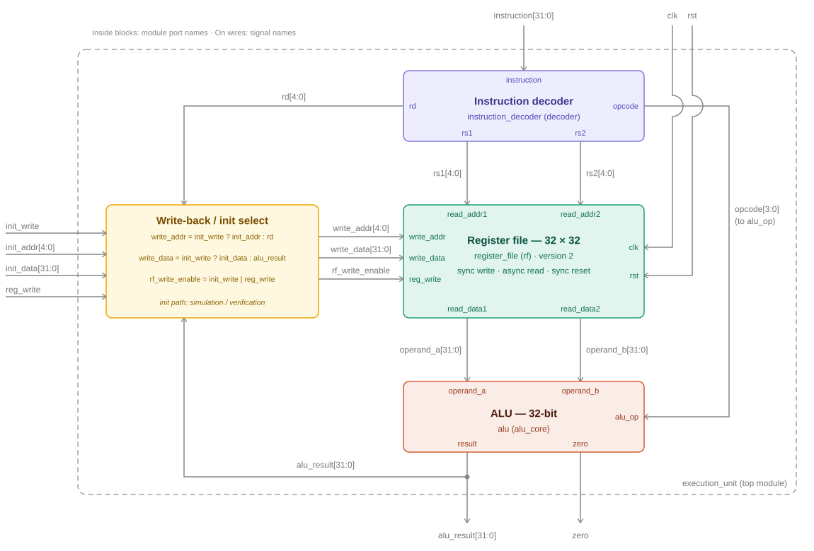

# Architecture — Execution Unit

## Overview

This document describes the architecture of the 32-bit Processor Execution Unit implemented in this project. The three functional blocks are integrated in the `execution_unit` top module.

| Module | File | Description | Status |
|--------|------|-------------|--------|
| Instruction Decoder | `rtl/instruction_decoder.v` | Decodes the 32-bit instruction into control signals | ✅ Complete |
| Register File (Version 2) | `rtl/register_file.v` | 32×32 register bank storing operands and results | ✅ Complete |
| ALU | `rtl/alu.v` | 32-bit arithmetic and logic unit with zero flag | ✅ Complete |
| Execution Unit (top) | `rtl/execution_unit.v` | Integrates the blocks and the write-back path | ✅ Complete |

---

## Block Diagram



Text view of the same structure:

```
                     32-bit Instruction
                              │
                              ▼
                  +----------------------+
                  | Instruction Decoder  |  ✅ Complete
                  | (combinational)      |
                  +----------------------+
                    │      │      │    │
                  rs1     rs2  opcode  rd ──► (to Write-Back / Init Select)
                    │      │      │
                    ▼      ▼      │
              +----------------------+
              |  Register File (v2)  |  ✅ Complete
              |       32 × 32        |
              +----------------------+
                  │            │      │
                  ▼            ▼      │
              Operand A    Operand B  │
                    \        /        │
                     \      /         │
                      ▼    ▼          ▼
                  +------------------------+
                  |          ALU           |  ✅ Complete
                  +------------------------+
                        │            │
                   alu_result       zero ──► output
                        │
                        ▼
            +------------------------------+      init_write
            |  Write-Back / Init Select    | ◄─── init_addr
            +------------------------------+      init_data
                        │                         reg_write
      write_addr · write_data · rf_write_enable
                        │
                        ▼
              Register File (write port)
```

---

## Module Descriptions

### 1. Instruction Decoder ✅ Complete — Verified

- Receives a **32-bit instruction**
- Extracts **opcode** (bits 31:28) — 4-bit operation code
- Extracts **rd** (bits 27:23) — 5-bit destination register address
- Extracts **rs1** (bits 22:18) — 5-bit source register 1 address
- Extracts **rs2** (bits 17:13) — 5-bit source register 2 address
- Purely **combinational** — `assign` statements
- Parameterized using `defines.vh` macros
- **Verified** — 3/3 test cases passed

---

### 2. Register File (Version 2) ✅ Complete — Verified

- **32 registers × 32-bit wide** (32×32)
- **Synchronous active-high reset**
- **Synchronous write** on the positive clock edge, controlled by `reg_write`
- **Dual asynchronous read ports** (`read_addr1` / `read_data1`, `read_addr2` / `read_data2`)
- Interface: `clk`, `rst`, `reg_write`, `write_addr`, `write_data`, `read_addr1`, `read_addr2`, `read_data1`, `read_data2`
- Version 1 (Day 3) named the write enable `we`; see [Day03_Update.md](Day03_Update.md)

---

### 3. ALU ✅ Complete — Verified

- Receives **Operand A** and **Operand B** from the Register File read ports
- Selects the operation with the 4-bit `alu_op`, driven by the decoder `opcode`
- **Purely combinational** — `always @(*)` with a `case` statement
- Produces a **32-bit `result`** and a **`zero` flag** (`result == 0`)
- **Verified** — 11/11 checks passed

| alu_op | Operation | Category |
|--------|-----------|----------|
| 0 | ADD | Arithmetic |
| 1 | SUB | Arithmetic |
| 2 | AND | Logical |
| 3 | OR | Logical |
| 4 | XOR | Logical |
| 5 | NOT | Logical |
| 6 | SLL | Shift |
| 7 | SRL | Shift |
| 8 | SLT | Comparison |
| 9 | PASS A | Pass-through |

---

### 4. Execution Unit (Top Module) ✅ Complete — Verified

```
execution_unit
    ├── instruction_decoder   ✅ Complete
    ├── register_file         ✅ Complete
    ├── alu                   ✅ Complete
    └── write-back / init select
```

**Interface**

| Port | Direction | Width | Description |
|------|-----------|-------|-------------|
| `clk` | Input | 1 | System clock |
| `rst` | Input | 1 | Reset, applied to the Register File |
| `reg_write` | Input | 1 | Normal write-back enable |
| `init_write` | Input | 1 | Register-initialization enable (simulation / verification) |
| `init_addr` | Input | 5 | Register to initialize |
| `init_data` | Input | 32 | Initialization value |
| `instruction` | Input | 32 | Instruction word |
| `alu_result` | Output | 32 | ALU result |
| `zero` | Output | 1 | ALU zero flag |

**Write-back / init select**

```
write_addr      = init_write ? init_addr : rd
write_data      = init_write ? init_data : alu_result
rf_write_enable = init_write | reg_write
```

The initialization path and normal write-back share the Register File's single write port. Initialization takes priority while `init_write` is high.

---

## Data Flow

```
1. 32-bit instruction → Instruction Decoder
2. Decoder extracts opcode, rs1, rs2, rd
3. Register File reads rs1 → Operand A and rs2 → Operand B
4. ALU performs the operation selected by opcode
5. Write-back select routes alu_result and rd to the Register File write port
6. With reg_write asserted, the result is written to rd on the next clock edge
```

---

*For instruction encoding details see [Instruction_Set.md](Instruction_Set.md)*
*For project progress see [Progress_Log.md](Progress_Log.md)*
*For Day 5 details see [Day05_Update.md](Day05_Update.md)*
