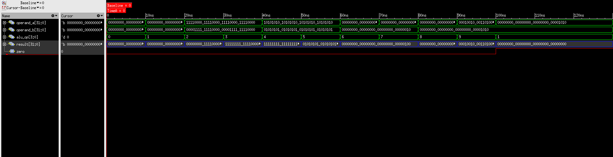

# Day 4 — ALU RTL & Verification

**Project:** Execution-Unit-RTL-to-GDSII
**Date:** *(To be filled)*
**Status:** ✅ Completed

---

## Objective

Implement the **32-bit ALU** in synthesizable Verilog HDL and verify every supported operation, plus the zero flag, using a directed self-checking testbench in Cadence Xcelium / SimVision. This completes the third and final functional block of the Execution Unit and clears the way for top-level integration.

---

## Files Implemented

| File | Location | Description |
|------|----------|-------------|
| `alu.v` | `rtl/alu.v` | Synthesizable 32-bit combinational ALU |
| `alu_tb.v` | `tb/alu_tb.v` | Directed testbench — 11 self-checking tests |
| `alu_waveform.png` | `images/simulation/alu_waveform.png` | SimVision waveform of the verified run |

---

## ALU Architecture

```
operand_a[31:0] ──►┌──────────────┐
                   │              │──► result[31:0]
operand_b[31:0] ──►│     ALU      │
                   │              │──► zero
alu_op[3:0]     ──►└──────────────┘
```

### Module Ports

| Port | Direction | Width | Description |
|------|-----------|-------|-------------|
| `operand_a` | Input | 32-bit | First operand (Register File read port 1) |
| `operand_b` | Input | 32-bit | Second operand (Register File read port 2) |
| `alu_op` | Input | 4-bit | Operation select |
| `result` | Output (reg) | 32-bit | Operation result |
| `zero` | Output | 1-bit | High when `result` equals zero |

---

## RTL Design

- **Purely combinational.** The operation is selected in an `always @(*)` block with a `case` statement on `alu_op`. There is no clock, reset or state.
- **Parameterized opcodes.** Operation codes come from macros in `defines.vh` (`ALU_ADD`, `ALU_SUB`, and so on), so the encoding is defined in one place.
- **Shift amount.** SLL and SRL use only `operand_b[4:0]`, which covers shifts of 0 to 31 on a 32-bit value.
- **Comparison.** SLT compares `operand_a` and `operand_b` as unsigned 32-bit values and returns `32'd1` or `32'd0`.
- **Default case.** Any `alu_op` value outside the ten defined operations returns `32'd0`.
- **Zero flag.** Generated with a continuous assignment, `zero = (result == 32'd0)`.

---

## Implemented Operations

| alu_op | Operation | Result | Category |
|--------|-----------|--------|----------|
| 0 | ADD | `operand_a + operand_b` | Arithmetic |
| 1 | SUB | `operand_a - operand_b` | Arithmetic |
| 2 | AND | `operand_a & operand_b` | Logical |
| 3 | OR | `operand_a \| operand_b` | Logical |
| 4 | XOR | `operand_a ^ operand_b` | Logical |
| 5 | NOT | `~operand_a` | Logical |
| 6 | SLL | `operand_a << operand_b[4:0]` | Shift |
| 7 | SRL | `operand_a >> operand_b[4:0]` | Shift |
| 8 | SLT | `1` if `operand_a < operand_b`, else `0` | Comparison |
| 9 | PASS A | `operand_a` | Pass-through |

> The `alu_op` values above are the encodings observed in the simulation waveform and match the opcode table in [Instruction_Set.md](Instruction_Set.md).

---

## Verification Method

The testbench applies one directed vector per operation, waits 10 ns, and compares `result` (or `zero`) against the expected value. Each check prints a `PASSED` or `FAILED` message. Because the ALU is combinational, no clock is needed. The run lasts about 130 ns.

**Tool:** Cadence Xcelium / SimVision
**Result:** ✅ All 11 checks passed

| # | Check | alu_op | operand_a | operand_b | Expected |
|---|-------|--------|-----------|-----------|----------|
| 1 | ADD | 0 | `10` | `20` | `result = 30` |
| 2 | SUB | 1 | `20` | `10` | `result = 10` |
| 3 | AND | 2 | `0xF0F0F0F0` | `0x0FF00FF0` | `result = 0x00F000F0` |
| 4 | OR | 3 | `0xF0F0F0F0` | `0x0FF00FF0` | `result = 0xFFF0FFF0` |
| 5 | XOR | 4 | `0xAAAAAAAA` | `0x55555555` | `result = 0xFFFFFFFF` |
| 6 | NOT | 5 | `0xAAAAAAAA` | — | `result = 0x55555555` |
| 7 | SLL | 6 | `1` | `2` | `result = 4` |
| 8 | SRL | 7 | `16` | `2` | `result = 4` |
| 9 | SLT | 8 | `5` | `10` | `result = 1` |
| 10 | PASS A | 9 | `0x12345678` | — | `result = 0x12345678` |
| 11 | ZERO FLAG | 1 (SUB) | `10` | `10` | `zero = 1` |

---

## Waveform Analysis



*Figure — ALU functional verification in Cadence SimVision.*

| Time window | alu_op | Observation |
|-------------|--------|-------------|
| 0–10 ns | 0 (ADD) | `result` shows the sum of the two operands |
| 10–20 ns | 1 (SUB) | `result` shows the difference |
| 20–30 ns | 2 (AND) | `result = 0x00F000F0` |
| 30–40 ns | 3 (OR) | `result = 0xFFF0FFF0` |
| 40–50 ns | 4 (XOR) | `result = 0xFFFFFFFF` |
| 50–60 ns | 5 (NOT) | `result = 0x55555555` |
| 60–70 ns | 6 (SLL) | `result = 4` |
| 70–80 ns | 7 (SRL) | `result = 4` (same value as SLL, so the trace does not change) |
| 80–90 ns | 8 (SLT) | `result = 1` |
| 90–100 ns | 9 (PASS A) | `result` equals `operand_a` (`0x12345678`) |
| 100 ns onward | 1 (SUB) | equal operands give `result = 0`, and `zero` rises to 1 |

The output changes in the same time step as the inputs, with no clock involved, which confirms purely combinational behavior.

---

## Verification Scope

**Covered by this testbench**

- One directed check for each of the 10 operations
- Zero flag assertion on a zero result

**Not covered yet — planned for system-level verification**

- Undefined `alu_op` values (10–15), which return zero in the RTL
- Edge-case operand values such as overflow, borrow and shifts by 31 or more
- Operation of the ALU when connected to the Register File and Instruction Decoder

---

## Learning Outcomes

- Implemented a synthesizable combinational ALU using `case` statements and parameterized opcode macros
- Generated a status flag from the result with a continuous assignment
- Built a directed self-checking testbench covering arithmetic, logical, shift, comparison and pass-through operations
- Read the ALU's combinational behavior directly from a SimVision waveform

---

## Next Step — Execution Unit Integration

**`rtl/execution_unit_top.v`**

- Instantiate and connect the Instruction Decoder, Register File and ALU
- Connect the Register File read ports to the ALU operands
- Connect the ALU result to the Register File write-back path
- Build a system-level testbench and verify in Cadence Xcelium

---

*See [Progress_Log.md](Progress_Log.md) for the full project timeline and [Architecture.md](Architecture.md) for the block diagram.*
