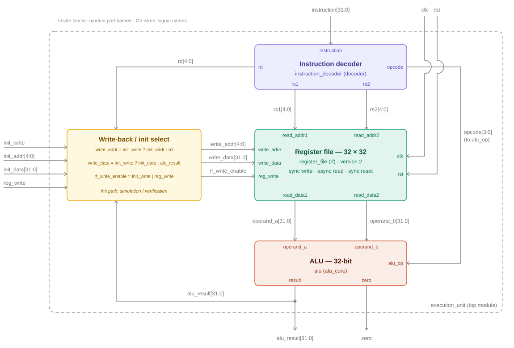
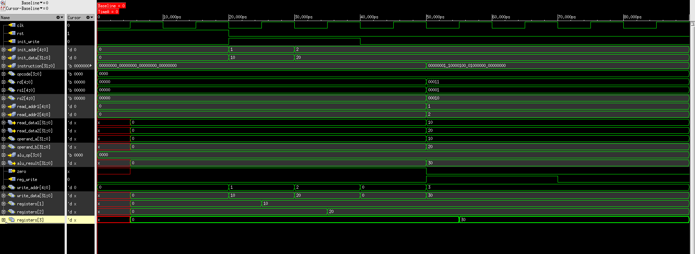

# Day 5 — Execution Unit Integration & Functional Verification

**Project:** Execution-Unit-RTL-to-GDSII
**Date:** Nov 4 2026
**Status:** ✅ Completed

---

## Objective

Integrate the Instruction Decoder, Register File (Version 2) and ALU into a single `execution_unit` top module, add a register-initialization interface so registers can be preloaded before instruction execution, and functionally verify the complete datapath in Cadence Xcelium / SimVision.

---

## Files

| File | Location | Description |
|------|----------|-------------|
| `execution_unit.v` | `rtl/execution_unit.v` | Execution Unit top module |
| `register_file.v` | `rtl/register_file.v` | Register File, Version 2 (replaces the Day 3 version) |
| `execution_unit_tb.v` | `tb/execution_unit_tb.v` | Execution Unit testbench |
| `execution_unit_waveform.png` | `images/simulation/execution_unit_waveform.png` | SimVision waveform of the verified run |

---

## Execution Unit Architecture



The top module contains three sub-modules and a small write-back select block:

```
execution_unit
    ├── instruction_decoder   (decoder)
    ├── register_file         (rf)
    ├── alu                   (alu_core)
    └── write-back / init select   (assign statements)
```

### Interface

| Port | Direction | Width | Description |
|------|-----------|-------|-------------|
| `clk` | Input | 1 | System clock |
| `rst` | Input | 1 | Reset, applied to the Register File |
| `reg_write` | Input | 1 | Normal write-back enable |
| `init_write` | Input | 1 | Register-initialization enable (simulation / verification) |
| `init_addr` | Input | 5 | Register to initialize |
| `init_data` | Input | 32 | Initialization value |
| `instruction` | Input | 32 | Instruction word |
| `alu_result` | Output | 32 | ALU result |
| `zero` | Output | 1 | ALU zero flag |

### Internal connections

| Signal | From → To |
|--------|-----------|
| `opcode` | Instruction Decoder → ALU `alu_op` |
| `rs1`, `rs2` | Instruction Decoder → Register File `read_addr1`, `read_addr2` |
| `rd` | Instruction Decoder → write-back select |
| `operand_a`, `operand_b` | Register File `read_data1`, `read_data2` → ALU |
| `alu_result` | ALU → write-back select and top-level output |
| `write_addr`, `write_data`, `rf_write_enable` | write-back select → Register File write port |

---

## Register Initialization Interface

`init_write`, `init_addr` and `init_data` let the testbench preload registers before an instruction executes. The RTL labels this interface as being for simulation and verification.

The initialization path is implemented in the top-level write-back select logic and shares the Register File's single write port with normal write-back:

```
write_addr      = init_write ? init_addr : rd
write_data      = init_write ? init_data : alu_result
rf_write_enable = init_write | reg_write
```

- When `init_write = 1`, the initialization path takes priority and `init_data` is written to `init_addr`.
- When `init_write = 0`, a write happens only if `reg_write = 1`, and the ALU result is written to the destination register `rd`.

---

## Register File — Version 2 Note

The integrated design uses Register File Version 2. As instantiated by `execution_unit`, its interface is `clk`, `rst`, `reg_write`, `write_addr`, `write_data`, `read_addr1`, `read_addr2`, `read_data1` and `read_data2`.

The Day 3 documentation and waveform ([Day03_Update.md](Day03_Update.md)) describe Version 1, in which the write enable was named `we`. The initialization interface lives in the `execution_unit` select logic, not inside the Register File.

---

## Verification Method

**Tool:** Cadence Xcelium / SimVision
**Clock:** 10 ns period (`always #5 clk = ~clk`)
**Test:** one directed scenario, checked by waveform inspection and a final `$display` of the instruction, ALU result and zero flag.

| Step | Value |
|------|-------|
| Initial state | `R1 = 10`, `R2 = 20` (loaded through the initialization interface) |
| Instruction | `ADD R3, R1, R2` |
| Encoding | `{4'b0000, 5'd3, 5'd1, 5'd2, 13'd0}` = `0x01844000` |
| Operand A / Operand B | `10` / `20` |
| ALU result | `30` |
| Write-back | `R3 = 30` |
| Zero flag | `0` |

### Testbench sequence

| Time | Action |
|------|--------|
| 0 ns | `rst = 1`, all other inputs low |
| 20 ns | `rst = 0`; `init_write = 1`, `init_addr = 1`, `init_data = 10` |
| 30 ns | `init_addr = 2`, `init_data = 20` |
| 40 ns | `init_write = 0` |
| 50 ns | Instruction applied; `reg_write = 1` |
| 70 ns | `reg_write = 0`; testbench prints the final values |
| 90 ns | `$finish` |

---

## Waveform Analysis



*Figure — complete execution-unit run in Cadence SimVision (0–90 ns).*

| Time | Stage | Observed behavior |
|------|-------|-------------------|
| 0–20 ns | Reset | `rst = 1`. Register and ALU signals are unknown until the first rising edge at 5 ns, then read `0`. |
| 20–30 ns | Register initialization | `init_write = 1`, `init_addr = 1`, `init_data = 10`. `write_addr` / `write_data` follow the init inputs. `registers[1]` becomes `10` at the 25 ns edge. |
| 30–40 ns | Register initialization | `init_addr = 2`, `init_data = 20`. `registers[2]` becomes `20` at the 35 ns edge. |
| 40–50 ns | Idle | `init_write = 0`, `reg_write = 0`. The instruction is `0`, so `rd = 0` and `alu_result = 0`. No register is written. |
| 50 ns | Instruction decode | `instruction = 0x01844000` gives `opcode = 0000`, `rd = 00011`, `rs1 = 00001`, `rs2 = 00010`. |
| 50 ns | Register read | `read_addr1 = 1`, `read_addr2 = 2`. `read_data1 = 10` and `read_data2 = 20` appear in the same time step because the read ports are asynchronous. |
| 50 ns | ALU operation | `operand_a = 10`, `operand_b = 20`, `alu_op = 0000` (ADD). `alu_result = 30`, `zero` drops to `0`. |
| 50–70 ns | Write back | `reg_write = 1`, `init_write = 0`. `write_addr = 3` (`rd`), `write_data = 30` (`alu_result`). |
| 55 ns | Register update | `registers[3]` becomes `30` at the rising clock edge. |

`reg_write` stays high for 20 ns, so two rising edges (55 ns and 65 ns) write the same value to R3. This is harmless here because R3 is not a source register for the instruction.

---

## Verification Summary

| Check | Result |
|-------|--------|
| Register initialization | ✅ Verified |
| Instruction decoding | ✅ Verified |
| Register reads | ✅ Verified |
| Operand forwarding to ALU | ✅ Verified |
| ALU computation | ✅ Verified |
| Write-back path | ✅ Verified |
| Register update | ✅ Verified |

---

## Verification Scope

**Covered**

- Initialization of two registers through the init interface
- One complete instruction (`ADD`) through decode, register read, ALU, write-back and register update

**Not covered yet**

- The other nine operations through the integrated datapath (they are verified at module level in [Day04_Update.md](Day04_Update.md))
- Back-to-back instructions and instructions that read the result of a previous one
- Automatic pass/fail comparison. This testbench relies on waveform inspection and a `$display` summary, unlike the earlier module-level testbenches.

---

## Learning Outcomes

- Integrated three verified RTL blocks into a top module using named port connections
- Designed a shared write port with an initialization path and a normal write-back path
- Traced one instruction through decode, register read, ALU and write-back in a single waveform
- Used internal register contents in SimVision to confirm state changes at specific clock edges

---

## Next Steps

1. **RTL optimization** of the integrated design
2. **Synthesis with Cadence Genus** — timing constraints, timing reports and gate-level netlist
3. **Physical design with Cadence Innovus** — floorplanning, placement, clock tree synthesis, routing, physical verification and GDSII generation

---

*See [Progress_Log.md](Progress_Log.md) for the full project timeline and [Architecture.md](Architecture.md) for the block diagram.*
