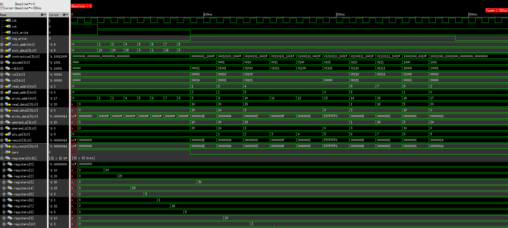

# Day 6 — Comprehensive Functional Verification of the Execution Unit

**Project:** Execution-Unit-RTL-to-GDSII
**Date:** *(To be filled)*
**Status:** ✅ Completed

---

## Objective

Verify every supported ALU operation through the complete integrated Execution Unit. Day 5 brought up the datapath with a single `ADD` instruction. Day 6 extends this to all ten operations with a self-checking testbench that compares expected and actual results and reports a PASS / FAIL summary.

---

## Files

| File | Location | Description |
|------|----------|-------------|
| `execution_unit_tb.v` | `tb/execution_unit_tb.v` | Execution Unit testbench, updated to a 10-operation self-checking test |
| `execution_unit_all_operations_waveform.png` | `images/simulation/execution_unit_all_operations_waveform.png` | Final SimVision waveform covering all ten operations |
| `execution_unit_simulation_transcript.txt` | `reports/execution_unit_simulation_transcript.txt` | Full simulation transcript |

---

## Test Setup

**Simulator:** Cadence Xcelium
**Waveform viewer:** Cadence SimVision

The testbench resets the design, preloads registers through the initialization interface (`init_write`, `init_addr`, `init_data`), and then runs one instruction for each ALU operation.

### Initial register state

| Register | Value |
|----------|-------|
| R1 | 10 |
| R2 | 20 |
| R4 | 15 |
| R5 | 3 |
| R6 | 1 |
| R7 | 16 |
| R8 | 5 |

### Path exercised by every instruction

```
Instruction
    ↓
Instruction Decoder
    ↓
Register File Read
    ↓
ALU Execution
    ↓
Write Back
    ↓
Destination Register Updated
```

### Self-checking method

For each test the testbench prints the test name, the expected ALU result, the actual ALU result and a `PASS` or `FAIL` verdict. After the last test it prints a summary with the total, passed and failed counts. Pass or fail is decided by comparing the expected value with `alu_result`. The write-back and destination-register update are observed in the SimVision waveform.

---

## Test Cases and Results

| Test | Operation | Expected ALU Result | Actual ALU Result | Result |
|------|-----------|---------------------|-------------------|--------|
| 1 | ADD | 30 | 30 | ✅ PASS |
| 2 | SUB | 10 | 10 | ✅ PASS |
| 3 | AND | 3 | 3 | ✅ PASS |
| 4 | OR | 15 | 15 | ✅ PASS |
| 5 | XOR | 12 | 12 | ✅ PASS |
| 6 | NOT | `0xFFFFFFF0` | `0xFFFFFFF0` | ✅ PASS |
| 7 | SHIFT LEFT | 8 | 8 | ✅ PASS |
| 8 | SHIFT RIGHT | 2 | 2 | ✅ PASS |
| 9 | SET LESS THAN (SLT) | 1 | 1 | ✅ PASS |
| 10 | PASS A | 20 | 20 | ✅ PASS |

The transcript prints the actual NOT result in lowercase hex (`fffffff0`) and the expected value in uppercase. The values are identical.

### Summary

| Metric | Value |
|--------|-------|
| Total operations verified | 10 |
| Passed | 10 |
| Failed | 0 |
| Status | ✅ ALL TESTS PASSED |

```
=========================================
EXECUTION UNIT VERIFICATION SUMMARY
=========================================
Total Tests : 10
Passed      : 10
Failed      : 0
STATUS : ALL TESTS PASSED
=========================================
```

Full transcript: [reports/execution_unit_simulation_transcript.txt](../reports/execution_unit_simulation_transcript.txt)

---

## Waveform Analysis



*Figure — complete Execution Unit run in Cadence SimVision covering all ten ALU operations.*

Across the run, `alu_op` changes with each instruction and `alu_result` takes the expected value for each test in turn:

| Test | Operation | `alu_result` |
|------|-----------|--------------|
| 1 | ADD | `30` |
| 2 | SUB | `10` |
| 3 | AND | `3` |
| 4 | OR | `15` |
| 5 | XOR | `12` |
| 6 | NOT | `0xFFFFFFF0` |
| 7 | SHIFT LEFT | `8` |
| 8 | SHIFT RIGHT | `2` |
| 9 | SLT | `1` |
| 10 | PASS A | `20` |

---

## Verification Scope

**Covered**

- All ten ALU operations through the complete integrated datapath, one directed instruction per operation
- Reset and register initialization through the init interface
- Automatic comparison of expected and actual ALU results with a PASS / FAIL summary

**Gaps from Day 5 that are now closed**

- The remaining nine operations through the integrated datapath
- Automatic pass / fail checking in the system-level testbench

**Not covered yet**

- Edge-case operand values such as overflow, borrow and shifts at the boundary
- Undefined `alu_op` values (10–15) at system level
- Dependent back-to-back instruction sequences

These are planned for re-verification after RTL optimization.

---

## Learning Outcomes

- Built a self-checking system-level testbench with expected-versus-actual comparison and summary counters
- Verified an integrated datapath end to end, from instruction decode to destination register update
- Used the initialization interface to make instruction tests repeatable
- Confirmed results against both the console transcript and the SimVision waveform

---

## Next Steps

1. **RTL optimization** of the integrated design
2. **Cadence Genus synthesis** — timing constraints, timing, area and power analysis, and gate-level netlist
3. **Cadence Innovus physical design** — floorplanning, placement, clock tree synthesis, routing, physical verification and GDSII generation

---

*See [Progress_Log.md](Progress_Log.md) for the full project timeline and [Day05_Update.md](Day05_Update.md) for the first datapath run.*
