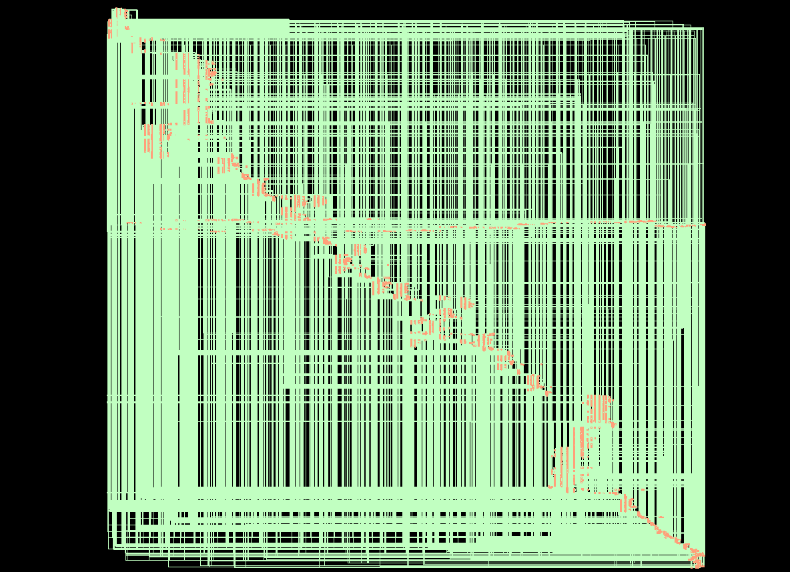

# Day 8 — RTL Synthesis using Cadence Genus

**Project:** Execution-Unit-RTL-to-GDSII
**Date:** *(To be filled)*
**Status:** ✅ Completed — RTL synthesized, gate-level netlist and reports generated

---

## Objective

Synthesize the complete Execution Unit RTL into a gate-level netlist using Cadence Genus and the 90 nm standard-cell library, using the SDC constraints and the automated script prepared on Day 7.

---

## Synthesis Setup

| Item | Configuration |
|------|---------------|
| Tool | Cadence Genus |
| Top module | `execution_unit` |
| Technology library | 90 nm standard-cell library — `slow.lib` |
| Operating corner | slow |
| Constraints | `constraints/execution_unit.sdc` |
| Clock | `clk`, 10 ns period (100 MHz) |
| Script | `synthesis/scripts/run_genus.tcl` |

### RTL files synthesized

| File | Description |
|------|-------------|
| `defines.vh` | Global macro definitions |
| `instruction_decoder.v` | Instruction Decoder |
| `register_file.v` | 32×32 Register File |
| `alu.v` | 32-bit ALU |
| `execution_unit.v` | Top module |

### Timing constraints

| Constraint | Value | Applied to |
|------------|-------|------------|
| Primary clock | `clk`, 10 ns period (100 MHz) | Port `clk` |
| Input delay | 2 ns relative to `clk` | All inputs except `clk` |
| Output delay | 2 ns relative to `clk` | All outputs |

---

## Synthesis Flow

```
RTL Design
    ↓
Read Technology Library
    ↓
Read RTL Files
    ↓
Design Elaboration
    ↓
Read Timing Constraints (SDC)
    ↓
Design Checking
    ↓
Generic Synthesis
    ↓
Technology Mapping
    ↓
Logic Optimization
    ↓
Synthesis Reports
    ↓
Gate-Level Netlist
```

The order follows `run_genus.tcl`: constraints are read after elaboration, and the reports are written before the netlist.

| Step | Command | Purpose |
|------|---------|---------|
| 1 | `read_lib` | Read the technology library |
| 2 | `read_hdl` | Read `defines.vh` and the four RTL modules |
| 3 | `elaborate execution_unit` | Elaborate the top module |
| 4 | `read_sdc` | Read the timing constraints |
| 5 | `check_design` | Check the design |
| 6 | `syn_gen` | Generic synthesis |
| 7 | `syn_map` | Technology mapping |
| 8 | `syn_opt` | Logic optimization |
| 9 | `report area / gates / timing / power` | Generate reports |
| 10 | `write_hdl` | Write the gate-level netlist |

---

## Generated Outputs

| Output | Location |
|--------|----------|
| Gate-level netlist | `synthesis/netlist/execution_unit_syn.v` |
| Area report | `synthesis/reports/area.rpt` |
| Gates report | `synthesis/reports/gates.rpt` |
| Timing report | `synthesis/reports/timing.rpt` |
| Power report | `synthesis/reports/power.rpt` |

---

## Synthesis Status

| Check | Status |
|-------|--------|
| RTL successfully synthesized | ✅ |
| Technology mapping completed | ✅ |
| Gate-level netlist generated | ✅ |
| Reports generated | ✅ |
| Synthesis errors | None encountered |

---

## Screenshots

### Gate-level schematic



*Synthesized gate-level schematic of `execution_unit`.*

### Generated reports


*Synthesis reports generated in `synthesis/reports/`.*

### Project directory after synthesis


*Project directory after synthesis.*

---

## Not Covered Yet

This update records that synthesis ran and produced its outputs. The reports have not been analyzed yet, so no area, gate, timing or power results are stated here. They will be documented in upcoming daily updates.

---

## Carry-Over Review Items for Report Analysis

- **Input-to-output path.** `instruction` reaches `alu_result` and `zero` through the decoder, the asynchronous register read and the ALU, all combinational. With 2 ns input and output delays, the window for this path is 10 ns − 2 ns − 2 ns = 6 ns. Check it in `timing.rpt`.
- **Constraint set.** The SDC holds the clock and the input and output delays only. Review whether further constraints are needed.
- **Paths.** `run_genus.tcl` uses absolute paths from the lab workstation. They need adjusting to run on another machine.

---

## Learning Outcomes

- Ran a complete RTL-to-gate-level synthesis with Cadence Genus from a single automated script
- Applied SDC timing constraints to an elaborated design
- Followed the generic synthesis, technology mapping and logic optimization stages
- Generated a gate-level netlist and synthesis reports for later analysis

---

## Next Steps

1. **Area analysis** — `synthesis/reports/area.rpt`
2. **Gate-level analysis** — `synthesis/reports/gates.rpt` and the netlist
3. **Timing analysis** — `synthesis/reports/timing.rpt`
4. **Power analysis** — `synthesis/reports/power.rpt`
5. **Physical design** with Cadence Innovus

---

*See [Progress_Log.md](Progress_Log.md) for the full project timeline and [Day07_Update.md](Day07_Update.md) for the synthesis environment setup.*
