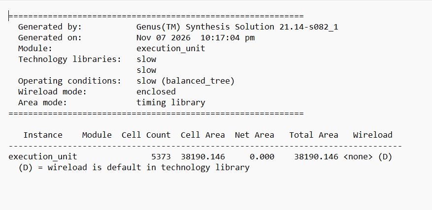

# Day 9 — Area Analysis after RTL Synthesis

**Project:** Execution-Unit-RTL-to-GDSII
**Date:** *(To be filled)*
**Status:** ✅ Completed — area report analyzed

---

## Objective

Analyze the area report generated by Cadence Genus after the RTL synthesis of the Execution Unit. The goal was to understand how the RTL was translated into standard cells and to evaluate the cell area of the synthesized design.

---

## Files

| File | Location | Description |
|------|----------|-------------|
| `area.rpt` | `synthesis/reports/area.rpt` | Area report generated by Cadence Genus |
| Area analysis screenshots | `images/synthesis/` | Area report, synthesis summary, Design Browser and terminal output |

---

## Area Report Summary

| Item | Value |
|------|-------|
| Top module | `execution_unit` |
| Technology library | 90 nm standard-cell library (`slow.lib`) |
| Library corner | slow |
| Wireload mode | enclosed |
| Operating condition | slow (balanced_tree) |

- **Wireload mode `enclosed`:** Genus applies the wireload model of the block that encloses each net.
- **Operating condition `slow (balanced_tree)`:** the slow operating condition with the `balanced_tree` wire model.

---

## Area Analysis Results

| Metric | Value |
|--------|-------|
| Cell Count | 5373 standard cells |
| Cell Area | 38190.146 µm² |
| Net Area | 0.000 µm² |
| Total Area | 38190.146 µm² |

Area values are reported in µm².

---

## Report Interpretation

- Synthesis mapped the RTL into **5373 standard-cell instances** using the 90 nm technology library.
- **Cell Area** is the total area of all synthesized standard cells.
- **Net Area** is the area attributed to wiring. It is `0.000` because synthesis runs before placement and routing, so no physical wiring exists yet.
- **Total Area** therefore equals the Cell Area.

---

## Key Learning

The area report shows how RTL code is transformed into technology-specific standard cells during synthesis. It gives insight into:

- Total hardware resources used by the design
- Standard-cell implementation of the RTL
- Design complexity before physical implementation

Area is important because it affects:

| Impact | Relationship |
|--------|--------------|
| Manufacturing cost | Larger area means fewer dies per wafer |
| Routing congestion | More cells need more wiring |
| Power consumption | More cells add leakage and switching capacitance |
| Overall chip size | Cell area sets a lower bound on the chip size |

Utilization and die size are physical-design results. They will be known after floorplanning in Cadence Innovus.

---

## Engineering Observation

The synthesis completed without errors, and the area report shows that the complete Execution Unit was mapped to the target technology library. The 10 ns clock constraint was in effect during this run, so this is the baseline area for that constraint.

The design is now ready for:

- Gate-level analysis
- Timing analysis
- Power analysis

---

## Screenshots

### Area report

*Area report generated by Cadence Genus for `execution_unit`.*

### Synthesis summary

*Synthesis summary with the total cell area highlighted.*

### Design Browser

*Genus Design Browser showing the synthesized `execution_unit` design.*

### Area report — terminal output

*Area report terminal output.*

---

## Not Covered Yet

This update covers the area report only. Gate-level, timing and power analysis will be documented in upcoming daily updates.

---

## Items to Check During Gate-Level Analysis

- **Cell count.** The total instance count in `gates.rpt` should match the 5373 cells in the area report.
- **Cell types.** Compare the sequential-cell count with the 32 × 32 = 1,024 bits of the Register File.

---

## Learning Outcomes

- Read and interpreted a Cadence Genus area report
- Distinguished cell area from net area and explained why net area is zero before physical design
- Related the mapped cell count to the design's complexity and its later physical-design impact

---

## Next Steps

1. **Gate-level analysis** — `synthesis/reports/gates.rpt` and the netlist
2. **Timing analysis** — `synthesis/reports/timing.rpt`
3. **Power analysis** — `synthesis/reports/power.rpt`
4. **Cadence Innovus setup** and physical design

---

*See [Progress_Log.md](Progress_Log.md) for the full project timeline and [Day08_Update.md](Day08_Update.md) for the synthesis run.*
